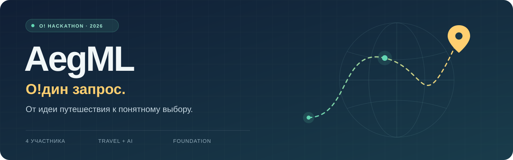

<p align="center">
  
</p>

<p align="center">
  <a href="https://github.com/osirust/AegML_OneRequest/actions/workflows/ci.yml"></a>
  
  
  
</p>

# AegML · О!дин запрос

Готовим AI-агента для путешествий и отелей на **[О! Хакатон 2026](https://ostrovok.tech/hackathon/)**. Хотим сократить путь от пожеланий путешественника до понятного выбора с проверяемыми условиями.

Сейчас здесь **публичный фундамент**: запускаемое офлайн-демо, общие контракты, план подготовки и правила совместной работы. Свободный текст, настоящая LLM, реальные цены, бронирование и веб-интерфейс пока не реализованы.

**[Команда](docs/TEAM.md) · [План](docs/ROADMAP.md) · [Архитектура](docs/ARCHITECTURE.md) · [Вопросы организаторам](docs/OPEN_QUESTIONS.md)**

## Первый запуск

Нужен только Python 3.11 или новее. Для демо не нужны GPU, ключи и установка библиотек.

```powershell
git clone https://github.com/osirust/AegML_OneRequest.git
cd AegML_OneRequest
py -m aegml --request examples/request.json
```

В Linux/macOS используйте `python3` вместо `py`. Запускайте команды из корня репозитория.

Демо принимает **структурированный JSON-запрос** и возвращает результат по вымышленным отелям. Источник и демонстрационный статус явно указаны в ответе. Данные не подтверждают цену, наличие номера или бронь. Если обязательных параметров не хватает, каркас возвращает вопросы; даты и бюджет не додумывает.

```powershell
py -m aegml --help
py -m aegml --request examples/incomplete-request.json
py -m unittest discover -s tests -v
```

## Что уже есть

| Часть | Состояние |
| --- | --- |
| Запрос, даты, гости, бюджет | Структурированный ввод и валидация |
| Каталог отелей | Только синтетические DEMO-данные |
| LLM | Контракт и выбор режима; настоящая модель не подключена |
| Локальный запуск / API | Предусмотрены отдельные режимы конфигурации |
| Работа команды | Четыре равных потока и перекрёстная проверка |
| Автоматические проверки | GitHub Actions на Linux и Windows |

## Модель выбирается после уточнения инфраструктуры

`AEGML_LLM_MODE` принимает `mock`, `local` или `api`. По умолчанию работает офлайн-демо. Режимы `local` и `api` сейчас явно сообщают, что интеграция не подключена. Это позволяет подготовить контракты до получения мощностей и доступа.

`.env.example` показывает имена настроек. Приложение **не загружает `.env` автоматически**: переменные нужно задать в окружении. Конкретная модель, GPU, лимиты и API-квоты организаторами для нашей команды пока не подтверждены.

## Четверо участников — четыре сопоставимых участка

| Участник | Основной участок | Проверяет участок |
| --- | --- | --- |
| 1 | Контракты и данные | 3 |
| 2 | Агент и интеграция LLM | 4 |
| 3 | Пользовательский сценарий и интерфейс | 1 |
| 4 | Качество, сборка и демонстрация | 2 |

У каждого — небольшой модуль, проверки и короткое демо. Координация распределяется по очереди; капитан входит в эти четыре места. Имена и GitHub-аккаунты добавим после согласования командой. [Подробный порядок работы →](docs/TEAM.md)

## Ближайшие даты

По [официальному календарю](https://ostrovok.tech/hackathon/), проверенному 19 октября 2026 года. Время — московское, UTC+3.

| Дата | Событие |
| --- | --- |
| 21 октября | Список участников |
| 23 октября | Открытие и доклад Островка |
| 24–28 октября | Работа над задачами; консультации 25 и 27 октября |
| **29 октября, до 10:00** | **Сдача решения** |
| 29 октября, после 19:00 | Объявление финалистов |
| 30 октября | Финал и награждение |

Состав MVP, источники данных и критерии готовности зафиксируем после выдачи задания. [Этапы и условия перехода →](docs/ROADMAP.md)

## Как устроен репозиторий

```text
aegml/                 # CLI, контракты и демонстрационные адаптеры
examples/              # синтетические входные запросы
tests/                 # проверки поведения каркаса
docs/                  # архитектура, команда и подготовка
.github/               # CI, шаблоны задач и pull request
PROJECT_STATE.md       # короткое актуальное состояние
```

Работаем небольшими изменениями через pull request. Принятый код должен запускаться у другого участника; сгенерированный код проверяем так же, как написанный вручную. [Как внести изменение →](CONTRIBUTING.md)

## Публикация и права

В репозитории — общая подготовка и синтетические примеры. Конкурсные материалы и данные публикуются только при наличии соответствующего разрешения. Возможность публикации итогового решения и его лицензию нужно уточнить с организаторами: [правила, раздел 7](https://ostrovok.tech/hackathon/docs/rules.pdf). Открытая лицензия на будущее конкурсное решение сейчас не назначена.

Это независимый репозиторий команды AegML, а не официальный продукт или репозиторий Островка.
