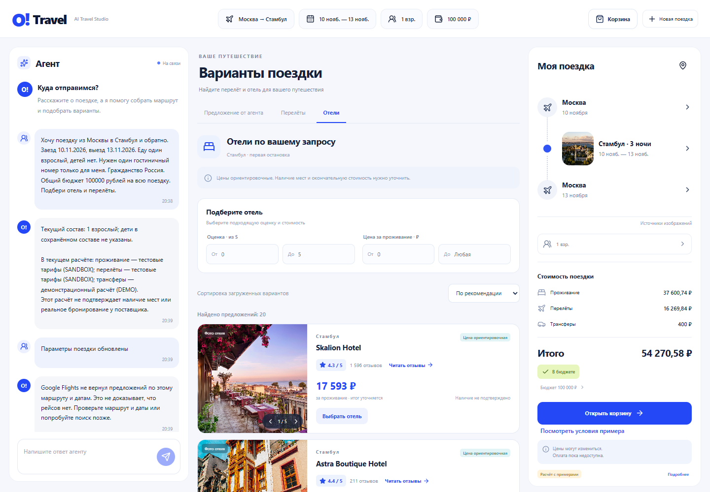

# O!Travel Agent — интеллектуальный конструктор путешествий


**Команда AegML · трек «О!дин запрос» · Ostrovok Hackathon 2026**

Опишите поездку обычными словами. Агент соберёт маршрут, проживание и перелёты, уточнит недостающие условия и поможет изменить весь план по ходу разговора. Состав группы, номера, даты и бюджет сохраняются между сообщениями.

**Видео демонстрации:** ссылка будет добавлена после записи.
<!-- VIDEO_URL: добавить общедоступную ссылку и проверить её без авторизации. -->

> «Из Казани в Стамбул, затем в Анталью. Двое взрослых и дети семи и четырёх лет, два номера. Нужны перелёты и отели в пределах общего бюджета».
>
> «Теперь перенеси возвращение на два дня, измени второй отель и покажи, что поменялось».

Ключевой сценарий — пересборка связанной поездки с сохранением остальных пожеланий. Модель предлагает операции, а backend проверяет их, сохраняет новую версию и получает предложения поставщиков. Цены и фотографии связаны с конкретными предложениями; оформление требует новой проверки и отдельного согласия.



*Реальный поиск Google Hotels через SerpApi: фотографии, оценки и цены конкретных отелей. Поисковая цена остаётся ориентировочной; скриншот не подтверждает наличие или бронь.*

## Запуск одной командой

Нужен **Docker с Docker Compose**. PostgreSQL, Python, Node.js и веб-сервер поднимаются в контейнерах; отдельно устанавливать их не требуется.

1. Получите проект архивом или через Git.
2. Положите конфигурацию в **`.env` рядом с `docker-compose.yml`**. Имя должно быть `.env`, а не `.env.txt`.
3. Укажите свою LLM по примеру ниже.
4. Выполните из папки проекта:

```sh
docker compose up --build
```

**Интерфейс: http://localhost:8080**

**Готовность backend и PostgreSQL: http://localhost:8080/health**

Первая сборка загружает Docker-образы и зависимости. Дождитесь готовности `app` и `web`. Если порт занят, задайте `APP_PORT=8082` в `.env` и откройте `http://localhost:8082`.

Данные хранятся в PostgreSQL volume и сохраняются при обычном перезапуске. Остановка — `docker compose down`; следующий запуск — той же командой `docker compose up --build`.

## Как подключить LLM жюри

Код агента менять не требуется. В **том же `.env`** выберите формат API, адрес сервера, идентификатор модели и свой ключ:

```dotenv
LLM_PROVIDER=external
LLM_API_FORMAT=openai
LLM_BASE_URL=https://your-llm-server.example/v1
LLM_MODEL=your-model-id
LLM_API_KEY=YOUR_API_KEY
LLM_EXTERNAL_API_CONFIRMED=true
```

Последний флаг означает, что принимающая сторона явно выбрала endpoint и разрешает обращаться к нему со своим ключом. Адрес задаётся конфигурацией сервера; сообщения пользователя его не меняют. Скрытого переключения на платную модель нет.

| Формат запросов | `LLM_API_FORMAT` | Пример `LLM_BASE_URL` |
| --- | --- | --- |
| Chat Completions / OpenAI-совместимый API | `openai` | `https://your-server.example/v1` |
| Родной Gemini GenerateContent | `gemini` | `https://generativelanguage.googleapis.com/v1beta` |
| Родной Anthropic Messages | `anthropic` | `https://api.anthropic.com/v1` |

OpenAI-совместимый формат не ограничивает производителя модели: так может работать сервер с Qwen, Gemma, Mistral и другими моделями. Для Gemini и Anthropic используются собственные форматы запросов и ответов.

Укажите **идентификатор модели из своего API**. Модель должна следовать JSON-контракту операций; backend проверяет ответ и ограничения поездки. Нестандартный протокол требует спецификации — по одному ключу определить его невозможно.

Если LLM-сервер работает на том же компьютере, используйте адрес вида `http://host.docker.internal:8000/v1`. Адрес `127.0.0.1` внутри контейнера относится к самому контейнеру. Для сервера без авторизации предусмотрено `LLM_AUTH_STYLE=none`; модель и формат всё равно указываются явно.

Дополнительные настройки Chat Completions необязательны:

```dotenv
# По умолчанию JSON запрашивается инструкцией, без специального параметра API.
LLM_JSON_MODE=prompt
# Для сервера, требующего другое имя поля, допустимо max_completion_tokens.
LLM_TOKEN_LIMIT_FIELD=max_tokens
```

Сохранены отдельные адаптеры **Z.ai, OpenRouter, Groq, Cloudflare Workers AI, Gemini и GigaChat**. Проверенный в разработке вариант Z.ai:

```dotenv
LLM_PROVIDER=zai
ZAI_MODEL=glm-4.5-flash
ZAI_API_KEY=YOUR_API_KEY
ZAI_FREE_TIER_CONFIRMED=true
```

Подтверждение Free задаётся для соответствующего аккаунта. Доступность и лимиты зависят от поставщика. Настройки отдельных адаптеров перечислены в `.env.example`.

После изменения `.env` повторите `docker compose up --build`. `/health` проверяет приложение и БД; успешный ответ LLM подтверждается отдельно первым сообщением в чате.

## Туристические API и ключи

**Ключи туристических сервисов проекта подготовлены для жюри в зашифрованном `secrets.env.age`.** Для этой поставки получать свои туристические ключи не потребуется. Открытых ключей в исходниках и браузере нет. **LLM-ключ указывает принимающая сторона.**

Файл зашифрован на публичного получателя организаторов по [официальной инструкции](https://docs.ostrovok.tech/s/b9e6ec5e-5ad6-4091-9c85-a48eee9b21cc/doc/shifrovanie-sekretov-klyuchej-6Qhc4gJOPZ). После расшифровки организаторы получают `.env`, добавляют параметры своей LLM и запускают проект командой выше. Записывающему демонстрацию команда передаёт отдельный приватный конфиг; без ключа организаторов расшифровать комплект жюри нельзя.

| Источник | Назначение | Режим данных |
| --- | --- | --- |
| [Nuitee / LiteAPI](https://docs.liteapi.travel/) | Отели, тарифы, размещение, сведения и фото конкретного отеля, перепроверка предложения | **Sandbox**: настоящий тестовый API, тестовые тарифы |
| [Duffel](https://duffel.com/docs) | Перелёты, пассажиры, маршруты, обновление предложений | **Test mode**: тестовые цены и доступность |
| [SerpApi Google Hotels](https://serpapi.com/google-hotels-api) / [Google Flights](https://serpapi.com/google-flights-api) | Поисковые цены, фото, оценки и отзывы отелей, классы перелётов | **Ориентировочные поисковые данные**, без гарантии наличия и покупки |
| [Open-Meteo](https://open-meteo.com/) | Погода и географический поиск | Внешний API; ключ не требуется |
| [Банк России](https://www.cbr.ru/development/sxml/) | Справочное сравнение RUB/USD/EUR | Исходные суммы сохраняются; пересчёт имеет источник и дату |

Маркировка сохраняется для каждого компонента: `DEMO` — синтетические данные, `SANDBOX` — тестовый API, `LIVE_INDICATIVE` — поисковая цена. Смешанный план не объявляется полностью реальным. `LIVE_BOOKABLE` зарезервирован для проверенного бронируемого источника; тестовые предложения не становятся им.

Для собственного развёртывания без переданного конфига необходим свой доступ к поставщикам. Имена настроек перечислены в `.env.example`; рабочий профиль проекта:

```dotenv
DEFAULT_SEARCH_MODE=HYBRID
DEFAULT_HOTEL_PROVIDER=liteapi
DEFAULT_FLIGHT_PROVIDER=duffel
LITEAPI_MODE=sandbox
SERPAPI_FREE_TIER_CONFIRMED=true
REFERENCE_FX_ENABLED=true
DYNAMIC_GEOGRAPHY_ENABLED=true
```

## Что показать в демонстрации

- Поездку с несколькими городами, взрослыми и детьми, номерами и общим бюджетом.
- Уточнения, опечатки, несовпадение города и страны, противоречивые даты.
- Изменение состава, возраста ребёнка, дат, бюджета или условий отдельного номера.
- Переключение эконома и бизнес-класса во вкладке «Перелёты»: выбранный класс передаётся поисковому источнику.
- Фото конкретного отеля, галерею, оценки и цену в правильных денежных единицах.
- Паузу с сохранением дополнений и продолжение по явной команде.
- Перепроверку условий, отдельное согласие и один локальный тестовый заказ.

**Корзина карточек** хранит предварительный выбор отдельных отелей и перелётов. **Проверка целого плана агента** получает серверную котировку: выбранные карточки не подменяют её состав и сумму. После перепроверки пользователь ставит галочку согласия и нажимает «Сохранить пример».

**Реальные бронирования и платежи не выполняются.** Результат — `BOOKED_DEMO` в PostgreSQL. Повтор подтверждения использует прежний ключ идемпотентности.

При отказе LLM или туристического API поездка сохраняется, доступны формы и явно обозначенный пример. Неподтверждённые цены, курс или расселение сопровождаются причиной блокировки и следующим действием.

## Архитектура и проверяемость

**React / Vite → Nginx → FastAPI / Agent Harness → PostgreSQL + адаптеры LLM и туристических API.**

PostgreSQL хранит поездку и её версии, сообщения, операции, запуски, предложения, котировки и локальные заказы. Модель предлагает изменения; код проверяет ограничения, происхождение цен, сохранение состояния и согласие. Сетевые вызовы выполняются вне длинной SQL-транзакции.

Проверки разделены на unit/domain, API с настоящим PostgreSQL, контролируемые ответы поставщиков, реальные внешние запросы, браузерные сценарии и диалоговые прогоны. Интеграционный прогон кода `a95eca8`: **7968 автоматических проверок PASS, без ошибок и пропусков** — [квитанция R27](docs/verification/r27-full-checkpoint-20261028.json). На том же кандидате выполнены [30 проверок чистого запуска Docker Compose и 25 проверок внешнего HTTP-формата с неизвестным именем модели](docs/verification/final-r27-clean-compose-and-external-wire-20261028.json). Реальные LLM и туристические API учитываются отдельными квитанциями; автоматический PASS не означает полную семантическую приёмку всех 40 диалогов или 106 сценариев.

Последняя правка интерфейса прошла **41 frontend-тест и production build**. [Браузерная проверка](docs/verification/r27-final-visible-ui-20261028.json) подтверждает свежий диалог, фото, галерею и восстановление страницы.

- [Контракт frontend/backend](docs/FRONTEND_CONTRACT.md)
- [Фотографии и их привязка](docs/HOTEL_MEDIA.md)
- [Подготовка сдачи и шифрование](docs/SUBMISSION.md)

Секреты остаются в `.env` и зашифрованном комплекте. При записи видео конфигурацию и содержимое ключей следует скрыть.
